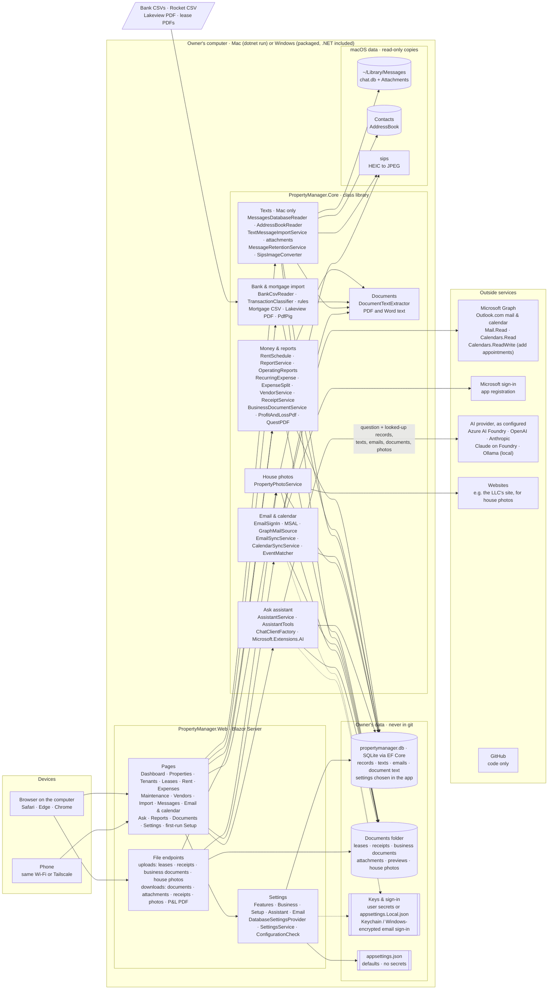

# Architecture

What runs where, where data is stored, and which outside services the app uses.

Notes:

- **Features** in the settings turn parts off (texts, email, calendar, the assistant, receipts, photos); a part that's off isn't shown, synced, or offered to the assistant.
- **Settings precedence**, lowest to highest: `appsettings.json` → user secrets → environment variables → `appsettings.Local.json` → choices saved on the Settings page.
- **Mac vs Windows:** text import and HEIC conversion use macOS (Messages database, `sips`); everything else is the same. The Windows package keeps the owner's data in `Documents\Property Manager`.
- **Only the AI provider** receives the owner's data, and only what's looked up for each question. Microsoft Graph is read-only.
